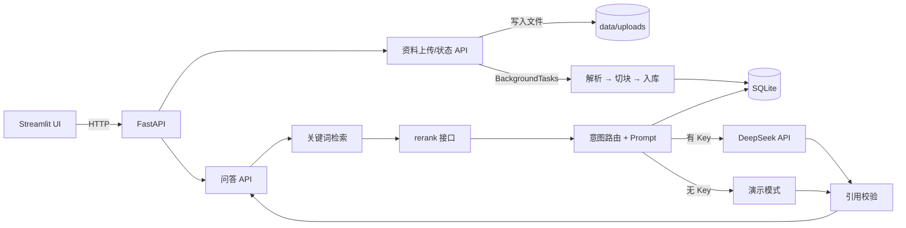
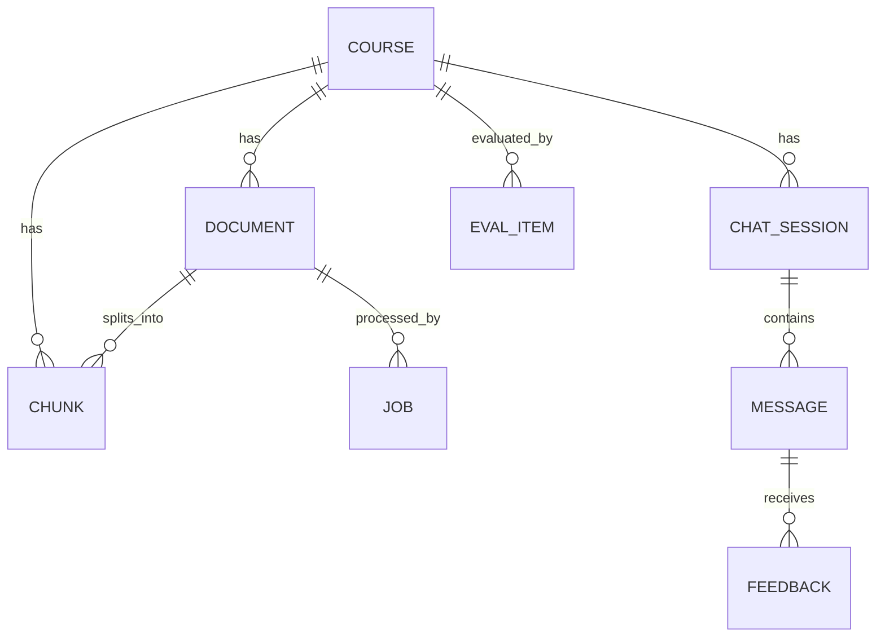

# 架构说明

## 总览

MVP 是单体应用：一个 FastAPI 进程 + 一个 SQLite 文件 + 一个 Streamlit 进程。选择单体是为了先验证数据质量和回答质量，而不是提前引入分布式复杂度。

## 模块地图

| 模块 | 职责 | 关键文件 |
| --- | --- | --- |
| 配置 | 环境变量、数据目录 | `app/core/config.py` |
| 数据层 | SQLAlchemy Base、Engine、Session | `app/db/` |
| 实体 | 课程、资料、块、任务、会话、消息、反馈、评测 | `app/models/entities.py` |
| 接入层 | Pydantic 请求/响应模型 | `app/schemas/` |
| 解析 | PPTX / PDF / TXT / MD → 按页文本 | `app/ingestion/parser.py` |
| 切块 | 按字符切块，保留页码/标题/类型 | `app/ingestion/chunker.py` |
| 入库 | 状态流转、去重、失败记录 | `app/ingestion/pipeline.py` |
| 检索 | 中文 n-gram 关键词召回与打分 | `app/retrieval/retriever.py` |
| 重排 | 可替换的 rerank 接口（当前透传） | `app/retrieval/reranker.py` |
| 引用 | 引用编号提取、越界清理 | `app/retrieval/citation.py` |
| Agent | 意图路由、Prompt、LLM 调用、降级 | `app/agent/` |
| 评测 | Recall@k 等指标 | `app/evaluation/metrics.py` |
| API | 路由与依赖 | `app/api/routes/` |
| 界面 | 上传、状态、聊天、引用展示 | `ui/streamlit_app.py` |

## 两条主链路

### 1. 资料入库

1. `POST /api/courses/{course_id}/documents` 校验后缀、大小和空文件。
2. 计算 SHA-256，同一课程下重复文件直接返回已有资料。
3. 文件写入 `data/uploads/`，创建 `Document(status=pending)` 和 `Job(status=pending)`。
4. 通过 FastAPI `BackgroundTasks` 调用 `process_document`。
5. 解析 → 切块 → 删除该资料的旧块 → 批量写入新块。
6. 成功时 `Document.status=ready`、`Job.status=success`；失败时记录 `error`。

注意：`BackgroundTasks` 随进程执行，进程重启会丢失未完成任务。这在上传后立即查询状态的单机 MVP 中可接受；上线前应替换为持久化队列。

### 2. 提问回答

1. `POST /api/chat` 校验课程与会话归属。
2. 保存用户消息，然后调用 `run_agent`。
3. `route_intent` 按关键词区分 `qa` / `summary` / `quiz`。
4. `search_chunks` 只检索 `Document.status=ready` 且属于当前课程的块：
   - 中文按 4/3/2-gram 扩展，英文/数字按 token 拆分；
   - SQL `LIKE` 召回候选（上限 200），按命中词数打分排序；
   - 交给 `rerank` 截断到 `top_k`。
5. 构建带页码的上下文，调用 DeepSeek（OpenAI 兼容接口）；未配置 Key 或调用失败时使用演示模式。
6. `strip_invalid_citations` 移除越界 `[n]`；若回答完全没有引用，则追加来源列表。
7. 保存助手消息（含引用 JSON、延迟、成本），返回答案与引用。

## 数据模型

- `Document.checksum` + 复合索引 `(course_id, checksum)` 用于去重。
- `Chunk.chroma_id` 为后续接入向量库预留，当前为空。
- `Message.citations_json` 保存当次引用快照，避免资料变更后无法追溯。
- `EvalItem` 和 `EvalRun` 已建模，当前评测脚本直接读 JSON 文件，尚未写入这两张表。

## 升级接口（预留的缝）

| 要替换的能力 | 当前实现 | 接入点 |
| --- | --- | --- |
| 向量检索 | 无 | 新增 embedding 写入 + `search_chunks` 内合并候选 |
| 混合检索 | 关键词 | `app/retrieval/retriever.py` |
| 重排模型 | 透传 | `app/retrieval/reranker.py` 的 `rerank` |
| LLM / 流式输出 | 同步 httpx | `app/agent/graph.py` 的 `_call_llm` |
| 内容类型识别 | 全部 `text` | `parser.py` 输出 `content_type`，`chunker.py` 透传 |
| 持久化任务队列 | BackgroundTasks | `documents.py` 的入队位置 |
| 评测入库 | JSON 文件 | `scripts/run_eval.py` + `EvalItem` / `EvalRun` |

## 设计取舍

- **SQLite**：单机、零运维、备份即复制文件；低并发写不是 MVP 瓶颈。多实例部署前迁移 MySQL。
- **同步 SQLAlchemy**：解析和 LLM 调用本身是阻塞的，MVP 不需要异步 ORM 带来的复杂度。
- **关键词基线**：先确认解析和切块质量，再评价向量检索的增量；否则无法区分是数据问题还是模型问题。
- **引用后校验**：LLM 的 `[n]` 不可信，必须在服务端校验后再展示。
- **失败可观测**：资料失败原因写入 `Document.error` / `Job.error`，UI 直接展示。
